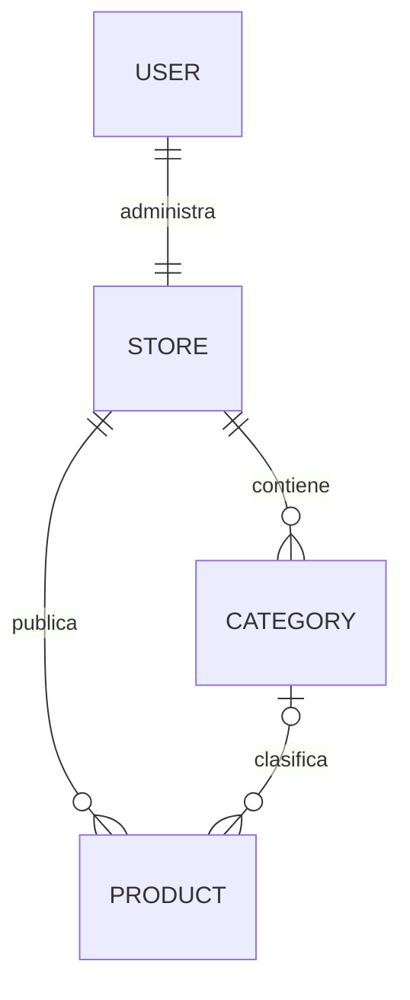

# Plan de trabajo — MVP SaaS Multi-Tienda
## 1. Estado actual

- Las funcionalidades principales de las Fases 0 a 8 están implementadas.
- La Fase 8 — Calidad y seguridad está completada.
- La navegación administrativa de la Fase 1 está completada.
- La Fase 2 — factories, seeders y datos de prueba está completada.
- La suite completa registra **92 pruebas aprobadas y 282 aserciones**.
- Validación manual local completada: catálogo, carrito, cantidades, eliminación, creación de pedido, WhatsApp y consulta administrativa.
- Las mejoras UI/UX prioritarias del MVP están completadas y validadas.
- La galería de imágenes de productos, optimización WebP y carrusel público están implementados y validados.
- La prueba gratuita de 14 días, los límites verificables en servidor y el ciclo de vida inicial de suscripciones están implementados y probados. Las transiciones `expired → grace_period → suspended` y la reactivación (servicio + UI) fueron validadas con 9 pruebas y 33 aserciones.
- **Avisos administrativos visibles en dashboard para `grace_period`, `suspended` y `expired` (badges con fechas y motivos).**
- **Control de acceso selectivo: lista blanca para `/dashboard`, `/store/settings`, `/subscriptions/reactivate` durante `grace_period` y `suspended`.**
- **Reactivación completa: servicio + UI con botón "Reactivar suscripción" en dashboard (solo `suspended`).**
- `Especificaciones.md` contiene el prototipo visual y funcional inicial.
- El proyecto Laravel fue creado en la carpeta `mvp`.
- Laravel instalado: versión 13.33.0.
- El desarrollo se realizará inicialmente en una laptop local.
- El despliegue de producción se realizará posteriormente en un VPS con Ubuntu.
- PostgreSQL será utilizado tanto en desarrollo como en producción.

## 2. Objetivo general

Construir un MVP de una plataforma para que un negocio pueda crear y administrar una tienda digital sencilla, publicar productos y recibir pedidos mediante WhatsApp.

El MVP debe permitir validar la idea con aproximadamente 3 a 10 negocios reales antes de desarrollar la plataforma SaaS completa.

## 3. Alcance funcional del MVP

### 3.1 Autenticación

- Registro de usuarios administradores.
- Inicio de sesión.
- Cierre de sesión.
- Protección de las rutas administrativas.
- Un usuario tendrá inicialmente una tienda.

### 3.2 Configuración de la tienda

- Nombre de la tienda.
- Identificador público o subdominio lógico.
- Número de WhatsApp.
- Moneda.
- Indicaciones de entrega.
- Estado de publicación de la tienda.

### 3.3 Categorías

- Crear categorías.
- Editar categorías.
- Eliminar categorías.
- Listar categorías.
- Asociar productos con categorías.

### 3.4 Productos

- Crear productos.
- Editar productos.
- Eliminar productos.
- Nombre.
- Precio.
- Categoría.
- Imagen.
- Disponibilidad.
- Validación de datos.
- Listado con búsqueda y filtro por categoría.

### 3.5 Catálogo público

- Página pública de la tienda.
- Visualización de productos disponibles.
- Filtrado por categoría.
- Diseño adaptable para dispositivos móviles.
- Identidad visual básica de la tienda.

### 3.6 Carrito

- Agregar productos.
- Modificar cantidades.
- Eliminar productos.
- Calcular subtotal y total.
- Conservar el carrito durante la sesión del visitante.

### 3.7 Pedido por WhatsApp

- Generar un mensaje con la información del pedido.
- Incluir productos, cantidades y precios.
- Incluir el total.
- Incluir datos básicos del cliente.
- Abrir WhatsApp mediante un enlace `wa.me`.

### 3.8 Persistencia

La información no debe depender de datos simulados en Alpine.js.

Se almacenará en PostgreSQL:

- Usuarios.
- Tiendas.
- Categorías.
- Productos.
- Pedidos.
- Detalles de pedidos.

## 4. Funciones fuera del alcance del MVP

Estas funciones se reservarán para etapas posteriores:

- Varias tiendas por usuario.
- Roles y permisos avanzados.
- Cobros recurrentes y gestión completa de suscripciones.
- Renovaciones y pagos reales.
- Estados futuros `past_due` y `cancelled`, vinculados a pagos y cancelaciones reales.
- Historial persistente de pagos y renovaciones reales.
- Afiliaciones mensuales automatizadas.
- Integración futura con pasarela de pagos y webhooks.
- Idempotencia, auditoría y conciliación de pagos.
- Integración con pasarelas de pago.
- Dominios personalizados.
- Subdominios reales automatizados.
- Estadísticas avanzadas.
- Inventario avanzado.
- Notificaciones automáticas de pedidos y otros módulos futuros.
- Aplicación móvil nativa.
- Integración oficial con la API de WhatsApp Business.
- Panel global de superadministrador.
- Facturación electrónica.
- Multi-idioma avanzado.
- Escalabilidad distribuida.

## 5. Stack tecnológico

### Aplicación

- Laravel.
- PHP 8.3.
- Blade.
- Alpine.js.
- Tailwind CSS.

### Base de datos

- PostgreSQL en desarrollo.
- PostgreSQL en producción.

### Herramientas

- Composer.
- Node.js.
- npm.
- Git.

### Producción

- VPS con Ubuntu.
- Nginx.
- PHP-FPM.
- PostgreSQL.
- HTTPS con Let's Encrypt y Certbot.
- Supervisor cuando se requieran procesos persistentes.
- Git para control de versiones y despliegues.

### Almacenamiento

Durante el MVP se utilizará almacenamiento local para las imágenes.

La estructura deberá quedar preparada para migrar posteriormente a:

- Amazon S3.
- Cloudinary.
- Otro servicio compatible con almacenamiento de objetos.

## 6. Arquitectura inicial

Durante el MVP se implementará una relación inicial de uno a uno:



Aunque inicialmente habrá una tienda por usuario, todas las entidades dependientes deberán relacionarse con `store_id` cuando corresponda. Esto facilitará evolucionar posteriormente hacia múltiples tiendas.


## 7. Modelo de datos previsto

### `users`
Tabla proporcionada por Laravel para usuarios autenticados.

### `stores`
Campos previstos:
* `id`
* `user_id`
* `name`
* `slug`
* `whatsapp`
* `currency`
* `delivery_notes`
* `is_published`
* `timestamps`

### `categories`
Campos previstos:
* `id`
* `store_id`
* `name`
* `slug`
* `timestamps`

### `products`
Campos previstos:
* `id`
* `store_id`
* `category_id`
* `name`
* `slug`
* `description`
* `price`
* `image_path`
* `is_available`
* `timestamps`

### `orders`
Campos previstos:
* `id`
* `store_id`
* `customer_name`
* `customer_phone`
* `customer_notes`
* `status`
* `total`
* `timestamps`

### `order_items`
Campos previstos:
* `id`
* `order_id`
* `product_id`
* `product_name`
* `quantity`
* `unit_price`
* `subtotal`
* `timestamps`

> **Nota:** Se conservarán `product_name` y `unit_price` en el detalle del pedido para mantener un historial correcto aunque el producto cambie posteriormente.

### `plans`
Campos implementados:
* `id`
* `name`
* `slug`
* `monthly_price`
* `max_products`
* `max_categories`
* `max_images_per_product`
* `is_active`
* `timestamps`

#### `subscriptions`

Campos implementados:
* `id`
* `store_id`
* `plan_id`
* `status`
* `started_at`
* `expires_at`
* `next_renewal_at`
* `grace_period_started_at`
* `grace_period_ends_at`
* `cancelled_at`
* `status_reason`
* `timestamps`

Relaciones y ciclo de vida implementados:

* `Subscription belongsTo Store`.
* `Subscription belongsTo Plan`.
* `Subscription hasMany SubscriptionReminder`.
* Transiciones `trialing → expired → grace_period → suspended`.
* Reactivación de suscripciones suspendidas.

Actualmente, cada nueva tienda recibe una suscripción activa del Plan Inicial. La prueba gratuita de 14 días del Plan Emprendedor está implementada mediante un flujo administrativo protegido, con `started_at` y `expires_at` persistidos. También están implementados los límites verificables en servidor para productos, categorías e imágenes y la transición de `trialing` a `expired` mediante servicio y comando Artisan.

#### `subscription_reminders`

Campos implementados:

* `id`
* `subscription_id`
* `type`
* `sent_at`
* `timestamps`

Restricciones y relaciones:

* Relación con `subscriptions` mediante `subscription_id`.
* Eliminación en cascada al eliminar la suscripción.
* Restricción única para evitar duplicar el mismo tipo de recordatorio por suscripción.
* Recordatorios configurados para 7, 3 y 1 día antes del vencimiento.

## 8. Fases de desarrollo

### 📍 Fase 0 — Planificación y entorno
- [x] Confirmar alcance.
- [x] Confirmar stack.
- [x] Documentar decisiones.
- [x] Crear repositorio Git.
- [x] Crear proyecto Laravel.
- [x] Configurar PostgreSQL.
- [x] Configurar variables de entorno.
- [x] Verificar que Laravel funcione localmente.

### 🏗️ Fase 1 — Estructura base
- [x] Configurar autenticación con Laravel Breeze.
- [x] Crear layout base generado por Breeze.
- [x] Configurar Tailwind.
- [x] Configurar Alpine.js.
- [x] Crear una ruta protegida inicial para el dashboard.
- [x] Cargar la tienda del usuario autenticado en el dashboard.
- [x] Crear navegación administrativa propia del negocio.
- [x] Completar la página inicial del panel administrativo mostrando los datos básicos de la tienda.

### 🗄️ Fase 2 — Base de datos
- [x] Crear migraciones de `stores`, `categories` y `products`.
- [x] Crear modelos Eloquent.
- [x] Definir relaciones entre usuarios, tiendas, categorías y productos.
- [x] Crear factories y seeders.
- [x] Ejecutar migraciones contra PostgreSQL.
- [x] Insertar datos iniciales de prueba.

### 🏬 Fase 3 — Tienda y categorías
- [x] Crear configuración de tienda.
- [x] Crear CRUD de categorías.
- [x] Agregar validaciones para la configuración de tienda.
- [x] Aplicar autorización básica para la configuración de la tienda del usuario autenticado.
- [x] Crear pruebas básicas de configuración de tienda.

### 📦 Fase 4 — Productos
- [x] Crear CRUD de productos.
- [x] Agregar búsqueda.
- [x] Agregar filtro por categoría.
- [x] Implementar disponibilidad.
- [x] Implementar carga y eliminación de imágenes.
- [x] Crear validaciones.
- [x] Crear pruebas básicas.

### 🌐 Fase 5 — Catálogo público
- [x] Crear ruta pública de tienda.
- [x] Mostrar información de la tienda.
- [x] Mostrar categorías.
- [x] Mostrar productos disponibles.
- [x] Crear diseño responsive.
- [x] Manejar tienda inexistente o no publicada.

### 🛒 Fase 6 — Carrito y pedidos
- [x] Implementar carrito mediante sesión.
- [x] Agregar y quitar productos.
- [x] Modificar cantidades.
- [x] Calcular totales.
- [x] Crear formulario básico del cliente.
- [x] Crear pedido persistente.
- [x] Generar mensaje para WhatsApp.

### 📊 Fase 7 — Gestión administrativa de pedidos
- [x] Listar pedidos de la tienda.
- [x] Mostrar detalles.
- [x] Mostrar cliente y total.
- [x] Actualizar estado.
- [x] Evitar que un usuario consulte pedidos de otra tienda.

### 🛡️ Fase 8 — Calidad y seguridad
- [x] Validar formularios.
- [x] Revisar autorización.
- [x] Revisar protección CSRF.
- [x] Revisar carga de archivos.
- [x] Revisar control de acceso.
- [x] Crear pruebas de funcionalidades principales.
- [x] Verificar comportamiento responsive.
- [x] Revisar mensajes de error.

### 🚀 Fase 9 — Evolución SaaS local: definición funcional
- [x] Definir los planes Inicial, Emprendedor y Profesional.
- [x] Definir límites iniciales de productos, categorías e imágenes.
- [x] Definir la prueba gratuita de 14 días para el Plan Emprendedor.
- [x] Definir recordatorios, periodo de gracia, suspensión y reactivación.
- [x] Documentar estados de suscripción y reglas de acceso.
- [x] Documentar buenas prácticas para pagos, webhooks e idempotencia.
- [x] Documentar la evolución futura de la landing SaaS.
- [x] Documentar el onboarding posterior al registro.

### 🚀 Fase 10 — Landing y onboarding SaaS
- [x] Crear landing inicial conectada al registro e inicio de sesión.
- [ ] Ampliar la propuesta de valor y las funcionalidades disponibles.
- [ ] Mostrar planes y límites sin activar cobros reales.
- [ ] Separar claramente funciones disponibles y futuras.
- [ ] Diseñar el onboarding posterior al registro.
- [ ] Validar los datos mínimos de la tienda antes de publicarla.
- [ ] Añadir páginas legales, SEO, accesibilidad y mejoras de rendimiento.

### 🚀 Fase 11 — Suscripciones y control de acceso
- [x] Diseñar la tabla `plans` con precios y límites configurables.
- [x] Crear el modelo `Plan` con atributos asignables y conversiones.
- [x] Añadir los planes comerciales al `DatabaseSeeder` de forma idempotente.
- [x] Añadir `PlanSeederTest` para validar los tres planes y sus límites.
- [x] Añadir pruebas unitarias para el modelo `Plan`.
- [x] Crear la tabla `subscriptions` vinculada a tiendas y planes.
- [x] Crear el modelo `Subscription` con estados, fechas y motivo.
- [x] Configurar las relaciones entre `Subscription`, `Store` y `Plan`.
- [x] Añadir pruebas unitarias de atributos, conversiones y relaciones.
- [x] Implementar y probar la transición de `trialing` a `expired`.
- [x] Crear el servicio `SubscriptionLifecycleService`.
- [x] Crear el comando `subscriptions:expire` para procesar expiración, periodo de gracia y suspensión, validado con una prueba Feature y 4 aserciones.
- [x] Implementar la suscripción inicial gratuita al registrar una tienda.
- [x] Implementar la prueba gratuita de 14 días del Plan Emprendedor.
- [x] Implementar límites verificables en servidor para productos, categorías e imágenes.
- [x] Implementar los estados `trialing`, `active`, `grace_period`, `suspended` y `expired`.
- [ ] Implementar posteriormente los estados `past_due` y `cancelled` con pagos y cancelaciones reales.
- [x] Implementar las transiciones `expired → grace_period → suspended`.
- [x] Registrar el scheduler diario de `subscriptions:expire`.
- [x] Validar el scheduler con una prueba Feature.
- [x] Implementar recordatorios persistentes de vencimiento para 7, 3 y 1 día.
- [x] Implementar notificaciones por correo para los recordatorios.
- [x] Programar el envío diario de recordatorios a las 09:00.
- [x] Verificar las tablas `jobs` y `failed_jobs` para procesar notificaciones en cola.
- [x] Implementar periodo de gracia de siete días.
- [x] Implementar suspensión sin eliminar datos al finalizar el periodo de gracia.
- [x] Bloquear el acceso administrativo de suscripciones suspendidas.
- [x] Implementar reactivación de suscripciones suspendidas.
- [x] Añadir pruebas automatizadas de las transiciones implementadas: 9 pruebas y 33 aserciones aprobadas.

### 🚀 Fase 12 — Pagos y renovaciones
- [ ] Elegir proveedor según país, moneda y mercado objetivo.
- [ ] Diseñar el historial de pagos y renovaciones.
- [ ] Diseñar la conciliación de pagos.
- [ ] Implementar webhooks con validación de firma.
- [ ] Implementar idempotencia para eventos externos.
- [ ] Registrar reembolsos e incidencias.
- [ ] No almacenar datos sensibles de tarjetas.
- [ ] Posponer cobros reales hasta autorización explícita.

### 🚀 Fase 13 — Funcionalidades avanzadas
- [ ] Inventario y control de stock.
- [ ] Gestión de clientes e historial de compras.
- [ ] Variantes de productos.
- [ ] Cupones y promociones.
- [ ] Estadísticas y métricas.
- [ ] Notificaciones de pedidos.
- [ ] Roles y permisos.
- [ ] Auditoría y registro de actividad.
- [ ] Exportación de datos.
- [ ] Centro de ayuda y soporte.

### 🚀 Fase 14 — Preparación para producción
- [ ] Configurar variables de producción sin exponer secretos.
- [ ] Configurar PostgreSQL en el VPS.
- [ ] Configurar Nginx y PHP-FPM.
- [ ] Configurar permisos de Laravel.
- [ ] Configurar almacenamiento público.
- [ ] Configurar HTTPS.
- [ ] Configurar backups.
- [ ] Configurar logs y monitorización.
- [ ] Ejecutar migraciones en producción.
- [ ] Autorizar explícitamente el inicio del despliegue.

### 9. Criterios de aceptación del MVP

El MVP se considerará exitoso y funcional cuando se completen los siguientes flujos de usuario:

#### 🏪 Flujo del Negocio (Administrador)
* **Autenticación:** Registrarse e iniciar sesión en la plataforma.
* **Configuración inicial:** Configurar los datos básicos de la tienda.
* **Gestión de catálogo:** Crear categorías y productos (incluyendo la carga de imágenes).
* **Control de visibilidad:** Activar o desactivar productos según disponibilidad.
* **Difusión:** Compartir el enlace del catálogo público de forma directa.
* **Gestión de órdenes:** Consultar los pedidos recibidos desde el panel administrativo y actualizar sus estados.

#### 🛒 Flujo del Visitante (Cliente)
* **Navegación:** Visualizar el catálogo público del negocio.
* **Compra:** Agregar productos al carrito y generar un pedido.
* **Finalización:** Enviar los detalles del pedido completado directamente por WhatsApp.

## 10. Estrategia de desarrollo
Se avanzará en pasos pequeños y verificables.

Cada tarea deberá:
* Tener un objetivo específico.
* Modificar la menor cantidad posible de archivos.
* Ejecutarse y probarse antes de continuar.
* Registrarse en este documento.
* Mantener el proyecto en un estado funcional.

No se implementarán simultáneamente funcionalidades de varias fases sin validar la fase anterior.

## 11. Estado de avance

### Completado
- [x] Definición de estrategia MVP antes de SaaS.
- [x] Confirmación del stack Laravel, Blade, Alpine.js y Tailwind CSS.
- [x] Confirmación de PostgreSQL.
- [x] Verificación de PHP.
- [x] Verificación de Composer.
- [x] Verificación de Node.js.
- [x] Verificación de npm.
- [x] Verificación de Git.
- [x] Verificación de pdo_pgsql.
- [x] Confirmación del desarrollo local.
- [x] Confirmación del despliegue futuro en VPS Ubuntu.
- [x] Crear el proyecto Laravel.
- [x] Inicializar Git.
- [x] Configurar PostgreSQL para Laravel.
- [x] Ejecutar las migraciones iniciales contra PostgreSQL.
- [x] Instalar autenticación con Laravel Breeze y Blade.
- [x] Verificar que Laravel funcione localmente.
- [x] Crear la migración y tabla `stores`.
- [x] Crear modelos y relaciones de usuarios, tiendas, categorías y productos.
- [x] Ejecutar las migraciones de tiendas, categorías y productos.
- [x] Crear automáticamente una tienda al registrar un usuario.
- [x] Agregar una prueba que verifica la creación automática de la tienda.
- [x] Configurar las pruebas para utilizar PostgreSQL.
- [x] Verificar la suite inicial: 56 pruebas y 162 aserciones exitosas (registro histórico).
- [x] Implementar el dashboard administrativo inicial.
- [x] Mostrar los datos básicos de la tienda autenticada.
- [x] Agregar pruebas de acceso autenticado y no autenticado al dashboard.
- [x] Implementar configuración editable de la tienda.
- [x] Agregar validación de configuración de tienda.
- [x] Agregar pruebas de visualización, actualización y acceso no autenticado.
- [x] Implementar CRUD de categorías con aislamiento por tienda.
- [x] Verificar el CRUD de categorías con pruebas automatizadas.
- [x] Agregar pruebas del CRUD de categorías y control de acceso por tienda.
- [x] Implementar CRUD de productos con aislamiento por tienda.
- [x] Agregar búsqueda, filtro por categoría y control de disponibilidad.
- [x] Crear pruebas del dominio de productos.
- [x] Crear pruebas de carga, reemplazo y eliminación de imágenes de productos.
- [x] Crear pruebas del catálogo público, disponibilidad, publicación y filtro por categoría.

### Pendiente

- [x] Carga y eliminación de imágenes.
- [x] Implementar catálogo público.
- [x] Implementar carrito mediante sesión, con 9 pruebas Feature y 25 aserciones exitosas.
- [x] Implementar pedidos persistentes y detalles de pedidos.
- [x] Generar enlaces de WhatsApp.
- [x] Implementar gestión administrativa de pedidos aislada por tienda.
- [x] Actualizar el estado de los pedidos desde el panel administrativo.
- [x] Navegación administrativa.
- [x] Seeders y datos de prueba.
- [x] Validar manualmente el flujo completo en entorno local.
- [ ] Preparar el despliegue, únicamente después de completar y validar la evolución SaaS local y recibir autorización explícita.

## 12. Instrucciones para retomar el proyecto con otra IA
Antes de realizar cambios, la IA deberá:
1. Leer este archivo completo.
2. Leer `Especificaciones.md`.
3. Revisar el estado de avance.
4. Revisar la estructura actual del proyecto.
5. Confirmar qué tarea se ejecutará.
6. Modificar solo los archivos necesarios.
7. Explicar cómo probar el cambio.
8. Actualizar la sección “Estado de avance” cuando corresponda.

La IA no deberá saltar a funciones SaaS mientras el MVP no cumpla sus criterios de aceptación.


## 13. Registro de continuidad para retomar el proyecto

### 13.1 Punto exacto de pausa

Fecha de actualización: 2026-10-28.

Las funcionalidades principales de las Fases 0 a 8 están implementadas, incluida la navegación administrativa, la gestión de pedidos, factories, seeders y la revisión de calidad y seguridad. Permanece pendiente la preparación para producción.

La suite completa registra 89 pruebas aprobadas y 270 aserciones.

La gestión administrativa de pedidos está implementada y aislada por tienda.

Los factories y seeders idempotentes están implementados y validados mediante `php artisan db:seed`.

Las mejoras UI/UX prioritarias del MVP están completadas y validadas. La galería de imágenes de productos, la optimización WebP y el carrusel público están implementados y validados.

La evolución SaaS local implementada incluye planes comerciales, suscripción inicial, prueba gratuita de 14 días, límites verificables en servidor, ciclo de vida `trialing → expired → grace_period → suspended`, reactivación, control de acceso administrativo, recordatorios persistentes de vencimiento, notificaciones por correo en cola y comandos Artisan programados.

El siguiente objetivo pendiente es implementar avisos administrativos visibles durante `grace_period`, mostrando el estado de la suscripción, la fecha de vencimiento y la fecha límite del periodo de gracia. La preparación para producción y los cobros reales quedan pospuestos.

Ya están implementados:

- Registro y autenticación con Breeze.
- Creación automática de una tienda al registrar un usuario.
- Planes comerciales `Inicial`, `Emprendedor` y `Profesional` implementados y sembrados de forma idempotente.
- Suscripción activa del Plan Inicial creada automáticamente para cada nueva tienda.
- Dashboard administrativo protegido.
- Visualización de los datos básicos de la tienda autenticada.
- Pruebas automatizadas del registro y dashboard.
- Suite de pruebas configurada con PostgreSQL.
- Configuración editable de la tienda implementada.
- Validación y pruebas de configuración implementadas.
- CRUD de categorías implementado con aislamiento por tienda.
- Pruebas del CRUD de categorías implementadas.
- CRUD de productos básico implementado con aislamiento por `store_id`.
- Búsqueda, filtro por categoría y disponibilidad implementados.
- Carga, reemplazo y eliminación de imágenes implementados con almacenamiento local.
- Catálogo público implementado con filtro por categoría y productos disponibles.
- Pruebas de productos, imágenes y catálogo público implementadas.
- Carrito mediante sesión implementado con agregar, acumular, actualizar, eliminar y calcular totales.
- Aislamiento del carrito por tienda implementado.
- Pruebas del carrito implementadas: 9 pruebas, 25 aserciones.
- Pedidos persistentes y detalles implementados.
- Enlaces `wa.me` generados con los datos del pedido.
- Gestión administrativa de pedidos implementada con aislamiento por tienda.
- Actualización administrativa del estado de los pedidos implementada.
- Pruebas de pedidos y gestión administrativa implementadas y exitosas.
- La suite completa fue ejecutada correctamente: 89 pruebas aprobadas y 270 aserciones.

También fueron validadas las pruebas específicas de suscripciones, recordatorios, notificaciones, comandos, scheduler y control de acceso.


### 13.2 Ubicación del proyecto

La carpeta raíz es:

```text
C:\Users\Jaime\Documents\Mis Documentos\Programacion\SaaS Multi Tienda
```

La aplicación Laravel está ubicada en:

```text
C:\Users\Jaime\Documents\Mis Documentos\Programacion\SaaS Multi Tienda\mvp
```

Los documentos principales son:

- `Plan_de_trabajo.md`
- `Especificaciones.md`

### 13.3 Versiones y herramientas verificadas

- **Laravel:** 13.33.0
- **PHP:** 8.3.16
- **Composer:** 2.9.8
- **Node.js:** 22.13.0
- **npm:** 10.9.2
- **Git:** 2.49.0.windows.1
- **PostgreSQL:** 18
- **Extensión PHP:** `pdo_pgsql`

### 13.4 Configuración de base de datos

La aplicación utiliza PostgreSQL tanto en desarrollo como en producción.

Configuración local prevista:

```env
DB_CONNECTION=pgsql
DB_HOST=127.0.0.1
DB_PORT=5432
DB_DATABASE=saas_multi_tienda
DB_USERNAME=postgres
```

La contraseña se encuentra únicamente en `mvp/.env` y nunca debe copiarse a este documento ni al repositorio.

Archivos de configuración:

- `mvp/.env`: configuración local privada; no versionar.
- `mvp/.env.example`: plantilla versionable, sin contraseña.
- No utilizar `.env.local` como archivo de configuración de Laravel.

La conexión fue verificada ejecutando correctamente:

```bash
php artisan migrate
```

### 13.5 Estado de Git

El repositorio Git válido está ubicado en la carpeta raíz:

```text
SaaS Multi Tienda\.git
```

No debe crearse otro repositorio Git dentro de `mvp`.

Los archivos HTML originales aparecieron como eliminados en `git status`; antes de confirmar esos cambios, la próxima IA debe verificar si fueron eliminados intencionalmente o si deben restaurarse.

No realizar `git add`, `commit`, `push` ni eliminación de archivos sin confirmar previamente la intención del usuario.

### 13.6 Autenticación instalada

Laravel Breeze fue instalado con Blade mediante:

```bash
composer require laravel/breeze --dev
php artisan breeze:install blade
```

La autenticación generada incluye:

- Registro.
- Inicio de sesión.
- Cierre de sesión.
- Recuperación de contraseña.
- Vistas Blade.
- Alpine.js.
- Tailwind CSS.

Los recursos frontend se compilaron correctamente con Vite.

La aplicación Laravel inició correctamente después de ejecutar:

```bash
php artisan key:generate
php artisan serve
```

No mostrar ni compartir el valor de `APP_KEY`.

### 13.7 Migraciones ejecutadas

Las migraciones predeterminadas de Laravel fueron ejecutadas:

- `users`
- `password_reset_tokens`
- `sessions`
- `cache`
- `jobs`

También fueron ejecutadas correctamente las migraciones del dominio:

- `stores`
- `categories`
- `products`
- `orders`
- `order_items`
- `plans`
- `subscriptions`

### 13.8 Modelos y relaciones implementados

#### `app/Models/User.php`

Relación implementada:

- `User hasOne Store`

#### `app/Models/Store.php`

Campos asignables:

- `user_id`, `name`, `slug`, `whatsapp`, `currency`, `delivery_notes`, `is_published`

Relaciones implementadas:

- `Store belongsTo User`
- `Store hasMany Categories`
- `Store hasMany Products`
- `Store hasMany Orders`
- `Store hasMany Subscriptions`

#### `app/Models/Category.php`

Campos asignables:

- `store_id`, `name`, `slug`

Relaciones implementadas:

- `Category belongsTo Store`
- `Category hasMany Products`

#### `app/Models/Product.php`

Campos asignables:

- `store_id`, `category_id`, `name`, `slug`, `description`, `price`, `image_path`, `is_available`

Conversiones configuradas:

- `price => decimal:2`
- `is_available => boolean`

Relaciones implementadas:

- `Product belongsTo Store`
- `Product belongsTo Category`

#### `app/Models/ProductImage.php`

Campos asignables:

- `product_id`, `path`, `sort_order`

Conversiones configuradas:

- `sort_order => integer`

Relaciones implementadas:

- `ProductImage belongsTo Product`

#### `app/Models/Order.php`

Campos asignables:

- `store_id`, `customer_name`, `customer_phone`, `customer_notes`, `status`, `total`

Conversiones configuradas:

- `total => decimal:2`

Relaciones implementadas:

- `Order belongsTo Store`
- `Order hasMany OrderItems`

#### `app/Models/OrderItem.php`

Campos asignables:

- `order_id`, `product_id`, `product_name`, `quantity`, `unit_price`, `subtotal`

Conversiones configuradas:

- `quantity => integer`
- `unit_price => decimal:2`
- `subtotal => decimal:2`

Relaciones implementadas:

- `OrderItem belongsTo Order`
- `OrderItem belongsTo Product`

#### `app/Models/Plan.php`

Campos asignables:

- `name`, `slug`, `monthly_price`
- `max_products`, `max_categories`, `max_images_per_product`
- `is_active`

Conversiones configuradas:

- `monthly_price => decimal:2`
- `max_products => integer`
- `max_categories => integer`
- `max_images_per_product => integer`
- `is_active => boolean`

Relaciones implementadas:

- `Plan hasMany Subscriptions`

#### `app/Models/Subscription.php`

Campos asignables:

- `store_id`, `plan_id`, `status`
- `started_at`, `expires_at`, `next_renewal_at`
- `grace_period_started_at`, `grace_period_ends_at`
- `cancelled_at`, `status_reason`

Conversiones configuradas:

- Fechas de suscripción a `datetime`.

Relaciones implementadas:

- `Subscription belongsTo Store`
- `Subscription belongsTo Plan`
- `Subscription hasMany SubscriptionReminder`

#### `SubscriptionReminder`

Campos asignables:

- `subscription_id`
- `type`
- `sent_at`

Conversión configurada:

- `sent_at => datetime`

Relación implementada:

- `SubscriptionReminder belongsTo Subscription`

#### Relación adicional de `Store`

- `Store hasMany Orders`
- `Store hasMany Subscriptions`

### 13.9 Tablas implementadas

#### Tabla: `stores`

Incluye:

- `user_id`, `name`, `slug`, `whatsapp`, `currency`, `delivery_notes`, `is_published`

#### Tabla: `categories`

Incluye:

- `store_id`, `name`, `slug`

*Nota: La combinación `store_id + slug` es única.*

#### Tabla: `products`

Incluye:

- `store_id`, `category_id`, `name`, `slug`, `description`, `price`, `image_path`, `is_available`

*Nota: La combinación `store_id + slug` es única. `category_id` es opcional y utiliza eliminación nula cuando se elimina una categoría.*

#### Tabla: `product_images`

Incluye:

- `product_id`, `path`, `sort_order`
- Eliminación en cascada al eliminar el producto.
- Índice por `product_id` y `sort_order`.

#### Tabla: `plans`

Incluye:

- `name`, `slug`, `monthly_price`
- `max_products`, `max_categories`, `max_images_per_product`
- `is_active`
- `slug` único para identificar cada plan.

#### Tabla: `subscriptions`

Incluye:

- `store_id`, `plan_id`, `status`
- `started_at`, `expires_at`, `next_renewal_at`
- `grace_period_started_at`, `grace_period_ends_at`
- `cancelled_at`, `status_reason`
- Índices por tienda, estado y próxima renovación.
- Eliminación en cascada al eliminar una tienda.
- Restricción al eliminar un plan utilizado por suscripciones.

#### `subscription_reminders`

Incluye:

- `subscription_id`
- `type`
- `sent_at`
- Restricción única por `subscription_id` y `type`.
- Eliminación en cascada al eliminar la suscripción.

#### Tabla: `orders`

Incluye:

- `store_id`, `customer_name`, `customer_phone`, `customer_notes`, `status`, `total`

#### Tabla: `order_items`

Incluye:

- `order_id`, `product_id`, `product_name`, `quantity`, `unit_price`, `subtotal`

*Nota: `product_id` es opcional y utiliza eliminación nula. `product_name` y `unit_price` conservan el historial del producto al momento de crear el pedido.*

### 13.10 Verificaciones de calidad y seguridad realizadas

- [x] Ejecutar la suite completa: 62 pruebas y 184 aserciones exitosas.
- [x] Verificar protección CSRF en los formularios Blade.
- [x] Revisar validaciones de productos, tienda, carrito y pedidos.
- [x] Revisar autorización y aislamiento por tienda.
- [x] Configurar y verificar el enlace `public/storage` para servir imágenes públicas.
- [x] Agregar y ejecutar prueba de cantidad inválida en el carrito: 8 pruebas y 22 aserciones exitosas.
- [x] Agregar y ejecutar prueba de formato de imagen no permitido en productos.
- [x] Confirmar la suite completa después de las mejoras: 62 pruebas y 184 aserciones exitosas.
- [x] Ejecutar la suite completa después de añadir el botón del catálogo: 62 pruebas y 184 aserciones exitosas.
- [x] Añadir botón protegido para agregar productos al carrito desde el catálogo público.
- [x] Verificar mediante `PublicCatalogTest` que el botón aparece para productos disponibles.
- [x] Mejorar la adaptación responsive de los formularios y filas del CRUD de categorías.
- [x] Ejecutar `CategoryTest` después de los cambios responsive.
- [x] Añadir mensajes de éxito y validación al panel administrativo de pedidos.
- [x] Ejecutar `OrderManagementTest` después de la mejora.

### 13.10.1 Funcionalidades pendientes

- Continuar la evolución post-MVP en entorno local.
- Preparar el despliegue en VPS únicamente después de completar y validar la etapa SaaS.

### 13.10.2 Posibles mejoras post-MVP

#### Evolución SaaS y suscripciones

##### Diseño funcional inicial

- [x] Definir los planes Inicial, Emprendedor y Profesional.
- [x] Definir límites de productos y categorías por plan.
- [x] Definir la prueba gratuita de 14 días para el Plan Emprendedor.
- [x] Definir los estados de suscripción y las reglas de acceso.
- [x] Implementar y probar `trialing`, `active`, `grace_period`, `suspended` y `expired`.
- [ ] Implementar `past_due` y `cancelled` junto con los pagos y cancelaciones reales.
- [x] Definir e implementar el periodo de gracia de 7 días y la suspensión temporal sin eliminar datos.
- [x] Posponer los cobros reales y la integración con pasarela hasta autorización explícita.

##### Plan Inicial — Gratis

- Precio: `$0`, permanente.
- Una tienda por usuario.
- Hasta 2 productos.
- Hasta 2 categorías.
- Una imagen optimizada por producto.
- Catálogo público, carrito y pedidos por WhatsApp.
- Panel básico de pedidos.
- Subdominio lógico de la plataforma.
- Soporte mediante documentación.
- Publicidad y marca visible de la plataforma.
- Sin estadísticas avanzadas, personalización avanzada ni soporte prioritario.

##### Plan Emprendedor — Crecimiento

- Precio: `$4.99 USD/mes`.
- Hasta 20 productos.
- Hasta 20 categorías.
- Galería de imágenes por producto.
- Historial completo de pedidos.
- Estadísticas básicas.
- Personalización básica de la tienda.
- Mayor capacidad de almacenamiento.
- Soporte prioritario.
- Sin publicidad de la plataforma.

##### Plan Profesional — Negocio

- Precio: `$9.99 USD/mes`.
- Hasta 500 productos.
- Categorías ampliadas.
- Mayor capacidad de almacenamiento.
- Estadísticas avanzadas.
- Gestión de clientes.
- Inventario y control de stock.
- Variantes de productos.
- Cupones y promociones.
- Exportación de pedidos.
- Soporte prioritario ampliado.

##### Prueba, renovaciones y vencimientos

- Prueba gratuita del Plan Emprendedor durante 14 días.

- [x] Implementar la prueba gratuita de 14 días del Plan Emprendedor mediante activación administrativa protegida.
- [x] Establecer `started_at` y `expires_at` automáticamente al iniciar la prueba.
- No solicitar tarjeta durante la prueba inicial.
- [x] Recordatorios 7, 3 y 1 día antes del vencimiento mediante `SubscriptionReminderService`.
- [x] Persistir recordatorios en `subscription_reminders` evitando duplicados.
- [x] Enviar notificaciones por correo mediante `SubscriptionExpirationReminder`.
- [x] Ejecutar diariamente `subscriptions:send-reminders` a las 09:00.
- [x] Implementar periodo de gracia de 7 días.
- [x] Suspender temporalmente la suscripción al finalizar el periodo de gracia.
- [x] Conservar los datos de la tienda durante la suspensión.
- [x] Bloquear el acceso administrativo de suscripciones suspendidas.
- [x] Implementar la reactivación de suscripciones suspendidas.

- [x] Crear el modelo de afiliación mensual de cada tienda.
- [x] Registrar fechas de inicio, próximo vencimiento y periodo de gracia.
- [x] Implementar y probar los estados utilizados: `trialing`, `active`, `grace_period`, `suspended` y `expired`.
- [ ] Implementar posteriormente los estados `past_due` y `cancelled` cuando exista un flujo real de pagos y cancelaciones.
- [ ] Crear historial de pagos, renovaciones, reembolsos e incidencias.
- [x] Implementar recordatorios previos al vencimiento para 7, 3 y 1 día.
- [ ] Implementar avisos visuales de pago y finalización del periodo de gracia en el dashboard.
- [x] Validar el acceso administrativo según el estado de la suscripción.
- [x] Suspender temporalmente una tienda sin eliminar sus datos.
- [x] Permitir la reactivación de una suscripción suspendida.
- [ ] Integrar posteriormente una pasarela de pagos adecuada al mercado objetivo.
- [ ] Procesar webhooks de pago con validación de firma e idempotencia.
- [ ] Evitar almacenar datos sensibles de tarjetas en la aplicación.
- [ ] Registrar auditoría de cambios de plan, pagos, renovaciones y suspensiones.
- [x] Añadir pruebas de vencimiento, gracia, suspensión, reactivación y recordatorios.
- [ ] Añadir pruebas de pagos duplicados cuando se implemente el sistema de pagos.

#### Landing page y conversión SaaS

- [ ] Ampliar la landing con propuesta de valor, beneficios y casos de uso.
- [ ] Diseñar un onboarding posterior al registro para configurar nombre comercial, slug, WhatsApp, moneda e indicaciones de entrega.
- [ ] Validar los datos mínimos de la tienda antes de publicar el catálogo.
- [ ] Añadir demostración visual del catálogo público y panel administrativo.
- [ ] Incorporar sección de características, ventajas y preguntas frecuentes.
- [ ] Presentar planes y precios conectados posteriormente con suscripciones reales.
- [ ] Añadir llamadas a la acción hacia registro e inicio de sesión.
- [ ] Mostrar información clara sobre prueba gratuita, límites y condiciones del servicio.
- [ ] Añadir testimonios o casos de éxito cuando existan negocios piloto.
- [ ] Mejorar SEO básico, metadatos, accesibilidad y rendimiento.
- [ ] Añadir páginas legales: términos, privacidad y política de cookies.
- [ ] Validar la landing en escritorio, tablet y móvil.

#### Otras mejoras funcionales

- [ ] Inventario y control de stock.
- [ ] Gestión de clientes e historial de compras.
- [ ] Roles y permisos.
- [ ] Variantes de productos.
- [ ] Cupones y promociones.
- [ ] Dashboard con métricas.
- [ ] Notificaciones de pedidos.
- [ ] Auditoría y registro de actividad.
- [ ] Evolución progresiva hacia varias tiendas por usuario.

### 13.10.3 Mejoras UI/UX registradas

- [x] Mejorar la cabecera responsive del catálogo público, incluyendo el botón de carrito y las indicaciones de entrega.
- [x] Ejecutar `PublicCatalogTest`: 3 pruebas aprobadas y 9 aserciones.
- [x] Mejorar la cabecera responsive del carrito, incluyendo el botón para volver a la tienda.
- [x] Ejecutar `CartTest`: 8 pruebas aprobadas y 22 aserciones.
- [x] Mejorar la tarjeta principal del dashboard, su jerarquía visual y adaptación responsive.
- [x] Ejecutar `ExampleTest`: 3 pruebas aprobadas y 7 aserciones.
- [x] Mejorar la navegación administrativa responsive, incluyendo el menú móvil y el botón hamburguesa.
- [x] Ejecutar `ExampleTest` después del cambio: 3 pruebas aprobadas y 7 aserciones.
- [x] Mejorar el fondo, espaciado y tarjeta responsive del layout público.
- [x] Ejecutar `ProfileTest` como validación disponible: 5 pruebas aprobadas y 21 aserciones.
- [x] Mejorar el fondo, espaciado y tarjeta responsive del layout público de autenticación.
- [x] Validar el cambio con `ProfileTest`: 5 pruebas aprobadas y 21 aserciones.
- [x] Traducir al español las etiquetas visibles de la vista inicial `welcome.blade.php`.
- [x] Validar manualmente la página inicial en `http://localhost:8000/`.
- [x] Mejorar la cabecera responsive de la gestión de productos y el enlace de retorno al dashboard.
- [x] Ejecutar `ProductTest`: 10 pruebas aprobadas y 41 aserciones.
- [x] Mejorar la cabecera responsive de la gestión de categorías y el enlace de retorno al dashboard.
- [x] Ejecutar `CategoryTest`: 7 pruebas aprobadas y 21 aserciones.
- [x] Mejorar la cabecera responsive de la gestión administrativa de pedidos y el enlace de retorno al dashboard.
- [x] Ejecutar `OrderManagementTest`: 2 pruebas aprobadas y 6 aserciones.
- [x] Mejorar la cabecera y el espaciado responsive de la configuración de la tienda.
- [x] Validar manualmente la vista `/store/settings`.
- [x] Ejecutar `StoreSettingsTest`: 3 pruebas aprobadas y 9 aserciones.
- [x] Mejorar el fondo general y el encabezado del layout administrativo.
- [x] Ejecutar `ExampleTest` después del cambio: 3 pruebas aprobadas y 7 aserciones.
- [x] Ejecutar la suite completa después de las mejoras UI/UX: 62 pruebas aprobadas y 184 aserciones.
- [x] Ajustar el layout público para permitir el desplazamiento completo del catálogo y verificar que los botones de agregar al carrito permanezcan accesibles.
- [x] Validar manualmente el agregado de productos desde el catálogo y la actualización de “En carrito: 1”.
- [x] Mostrar “Volver a la tienda” en el carrito vacío usando la última tienda pública visitada.
- [x] Añadir y ejecutar la prueba del carrito vacío: 9 pruebas aprobadas y 25 aserciones.
- [x] Validar manualmente el enlace “Volver a la tienda” desde un carrito vacío y confirmar el retorno al catálogo.
- [x] Mejorar visualmente el estado vacío del carrito con mensaje, icono y botón “Explorar productos”.
- [x] Ejecutar `CartTest` después de la mejora: 9 pruebas aprobadas y 25 aserciones.
- [x] Validar manualmente el estado vacío del carrito y el botón “Explorar productos”.
- [x] Ejecutar la suite completa después de la mejora del carrito vacío: 62 pruebas aprobadas y 184 aserciones.
- [x] Añadir accesos directos “Ver tienda” y “Configurar tienda” al dashboard.
- [x] Configurar “Ver tienda” para abrirse en una nueva pestaña con `noopener noreferrer`.
- [x] Validar manualmente que el catálogo se abre en una nueva pestaña y el dashboard permanece disponible.
- [x] Ejecutar `ExampleTest` después de la mejora del dashboard.
- [x] Ejecutar la suite completa después de la mejora del dashboard: 62 pruebas aprobadas y 184 aserciones.
- [x] Traducir las etiquetas de navegación “Perfil” y “Cerrar sesión”.
- [x] Ejecutar `AuthenticationTest` después del cambio: 4 pruebas aprobadas y 8 aserciones.
- [x] Mejorar la presentación responsive de la gestión de productos mediante tarjetas, separación visual y controles accesibles.
- [x] Ejecutar `ProductTest` después de la mejora: 10 pruebas aprobadas y 41 aserciones.
- [x] Validar manualmente en vista móvil la gestión de productos, incluyendo formularios y acciones “Guardar” y “Eliminar”.
- [x] Ejecutar la suite completa después de las mejoras de productos: 62 pruebas aprobadas y 184 aserciones.
- [x] Mejorar la presentación responsive de categorías mediante tarjetas y acciones accesibles para “Guardar” y “Eliminar”.
- [x] Ejecutar `CategoryTest` después de la mejora: 7 pruebas aprobadas y 21 aserciones.
- [x] Validar manualmente en vista móvil las etiquetas “Perfil” y “Cerrar sesión” del menú responsive.
- [x] Validar manualmente en vista móvil la gestión de categorías, incluyendo formularios y acciones “Guardar” y “Eliminar”.
- [x] Ejecutar la suite completa después de las mejoras de categorías: 62 pruebas aprobadas y 184 aserciones.
- [x] Mejorar la presentación responsive de la gestión administrativa de pedidos mediante tarjetas, jerarquía visual y controles accesibles.
- [x] Ejecutar `OrderManagementTest` después de la mejora: 2 pruebas aprobadas y 6 aserciones.
- [x] Validar manualmente en vista móvil la gestión administrativa de pedidos, incluyendo tarjetas, estados, productos y totales.
- [x] Ejecutar la suite completa después de las mejoras de pedidos: 62 pruebas aprobadas y 184 aserciones.
- [x] Mejorar la jerarquía visual y el espaciado responsive de la configuración de la tienda.
- [x] Ejecutar `StoreSettingsTest` después de la mejora: 3 pruebas aprobadas y 9 aserciones.
- [x] Validar manualmente en vista móvil la configuración de la tienda, incluyendo campos, publicación y guardado.
- [x] Ejecutar la suite completa después de las mejoras de configuración: 62 pruebas aprobadas y 184 aserciones.
- [x] Diseñar la migración `product_images`, conservando `products.image_path` como imagen principal compatible.
- [x] Crear el modelo `ProductImage` y las relaciones con `Product`.
- [x] Ejecutar `ProductTest`: 10 pruebas aprobadas y 41 aserciones.
- [x] Añadir carga simultánea de imagen principal y galería desde el formulario de productos.
- [x] Implementar redimensionado proporcional y conversión automática a WebP.
- [x] Implementar reemplazo y eliminación segura de imágenes principales y adicionales.
- [x] Implementar carrusel público responsive y accesible.
- [x] Añadir pruebas de carga, optimización, reemplazo, eliminación y visualización pública.
- [x] Crear landing inicial conectada a las rutas reales de registro e inicio de sesión.
- [x] Validar manualmente la landing en escritorio y móvil.

### 13.11 Próximo paso recomendado

La Fase 8 — Calidad y seguridad está completada. La suite actual registra **92 pruebas aprobadas y 282 aserciones**.

Las mejoras UI/UX prioritarías, la galería de imágenes, la optimización WebP y el carrusel público están implementados y validados.

La evolución SaaS local implementada incluye:

- Planes comerciales y suscripción inicial.
- Prueba gratuita de 14 días.
- Límites verificables en servidor.
- Ciclo de vida `trialing → expired → grace_period → suspended`.
- Reactivación de suscripciones suspendidas (servicio + UI).
- Control de acceso administrativo selectivo (lista blanca).
- Recordatorios persistentes a 7, 3 y 1 día.
- Notificaciones por correo en cola.
- Comandos Artisan y scheduler diario.
- **Avisos administrativos visibles en dashboard para `grace_period`, `suspended` y `expired` (badges con fechas y motivos).**
- **Botón "Reactivar suscripción" en dashboard (solo `suspended`).**

El siguiente objetivo pendiente es implementar el historial de transiciones de suscripción (tabla, modelo, registro de cambios de estado, fecha, motivo, origen).

Los pagos reales, la integración con pasarelas, los webhooks y la preparación para producción permanecen pospuestos.

Estado confirmado:

- La tienda se crea automáticamente al registrar un usuario.
- El `slug` inicial se genera como `mi-tienda-{user_id}`.
- El dashboard protegido carga la tienda del usuario autenticado.
- La configuración de tienda está implementada y validada.
- El CRUD de categorías cuenta con aislamiento entre tiendas.
- El CRUD de productos cuenta con aislamiento, disponibilidad y gestión de imágenes.
- El catálogo público muestra productos disponibles y permite agregarlos al carrito.
- El carrito mediante sesión está implementado y aislado por tienda.
- Los pedidos persistentes y sus detalles están implementados.
- La generación de enlaces `wa.me` está implementada.
- El panel administrativo permite consultar y actualizar pedidos propios.
- **Dashboard muestra badges de estado: `grace_period` (ámbar, dos fechas), `suspended` (rojo, motivo), `expired` (gris, fecha).**
- **Botón "Reactivar suscripción" visible solo en estado `suspended`.**
- **Historial de transiciones de suscripción implementado: tabla `subscription_histories`, modelo `SubscriptionHistory`, registro automático en cada cambio de estado (origen: `system` o `user`).**
- La suite completa está validada con **99 pruebas y 298 aserciones**.
- El flujo completo de compra fue validado manualmente en local, incluyendo la consulta del pedido desde el panel administrativo.

Orden recomendado:

1. ✅ **Completado**: Implementar avisos administrativos visibles durante `grace_period`, `suspended` y `expired` en dashboard.
2. ✅ **Completado**: Middleware `EnsureActiveSubscription` - lista blanca para `/dashboard`, `/store/settings`, `/subscriptions/reactivate`.
3. ✅ **Completado**: Ruta `POST /subscriptions/reactivate` y método en `SubscriptionController`.
4. ✅ **Completado**: Botón "Reactivar suscripción" en dashboard (solo `suspended`).
5. ✅ **Completado**: Pruebas automatizadas: `GracePeriodDashboardTest`, `SubscriptionAccessTest` actualizado.
6. ✅ **Completado**: Historial de transiciones de suscripción (tabla, modelo, registro de cambios de estado, fecha, motivo, origen).
   - Migración `create_subscription_histories_table` con campos: `subscription_id`, `from_status`, `to_status`, `reason`, `origin`, `changed_at`.
   - Modelo `SubscriptionHistory` con relación `belongsTo(Subscription)` y casts.
   - Relación `hasMany(SubscriptionHistory)` en modelo `Subscription` ordenada por `changed_at`.
   - Registro automático en `SubscriptionLifecycleService`: `trialing→expired`, `expired→grace_period`, `grace_period→suspended`, `suspended→active` (origen: `system`).
   - Registro en `SubscriptionController::startEntrepreneurTrial`: `null→trialing` (origen: `user`).
   - Factory `SubscriptionHistoryFactory` y pruebas unitarias `SubscriptionHistoryTest` (7 tests, 16 aserciones).
7. **PENDIENTE** — Diseñar pagos, renovaciones y cancelaciones reales (requiere definición previa del método de pago / pasarela).
8. Posponer la integración de pagos reales y producción hasta nueva autorización explícita.

### 13.12 Procedimiento obligatorio para la próxima IA

Antes de modificar código:

1. Leer `Plan_de_trabajo.md` completo.
2. Leer `Especificaciones.md`.
3. Revisar `git status`.
4. Revisar `mvp/.env.example`, sin solicitar ni mostrar secretos de `mvp/.env`.
5. Revisar las migraciones, modelos, rutas y pruebas relacionadas con suscripciones, si ya existen.
6. Confirmar que no se acceda ni se muestre `mvp/.env`.
7. Revisar el estado actual de la implementación de suscripciones y límites, sin modificar código durante la revisión inicial.
8. Confirmar cuál será la primera tarea.
9. Modificar un solo objetivo funcional por vez.
10. Ejecutar una prueba después de cada cambio.
11. Actualizar este documento al completar una tarea.

La próxima IA debe comenzar informando:

> He leído el plan de trabajo. El MVP y la evolución SaaS local implementada incluyen autenticación, tiendas, categorías, productos, imágenes, catálogo público, carrito, pedidos persistentes, enlaces `wa.me`, panel administrativo, planes comerciales, prueba gratuita, límites verificables, ciclo de vida de suscripciones, reactivación completa (servicio + UI), control de acceso selectivo con lista blanca (`/dashboard`, `/store/settings`, `/subscriptions/reactivate`), recordatorios, notificaciones por correo, comandos Artisan y scheduler. **Dashboard muestra avisos para `grace_period`, `suspended` y `expired` (badges con fechas/motivos) y botón "Reactivar suscripción" (solo `suspended`).** La suite completa registra **92 pruebas aprobadas y 282 aserciones**. El siguiente objetivo es implementar el historial de transiciones de suscripción (tabla, modelo, registro de cambios de estado, fecha, motivo, origen), sin modificar código durante la revisión inicial.

### 13.13 Reglas de seguridad y mantenimiento

- Nunca compartir contraseñas, `APP_KEY` ni valores privados de `.env`.
- No reemplazar `.env` por `.env.example` sin advertir que se perderían configuraciones locales.
- No ejecutar migraciones destructivas sin confirmación.
- No eliminar archivos originales sin confirmar.
- No crear un repositorio Git dentro de `mvp`.
- No implementar funciones SaaS antes de completar y validar el MVP.
- Una vez validado el MVP, las funciones post-MVP deberán desarrollarse inicialmente en entorno local, con pruebas y sin iniciar producción hasta autorización explícita.
- Mantener PostgreSQL como base de datos de desarrollo y producción.
- Mantener cada cambio pequeño, comprobable y documentado.

### 13.14 Datos y URLs a probar

#### Datos de acceso locales

- Usuario demo: `demo@example.com`
- Contraseña: password.
- Tienda demo: `Tienda Demo`
- Slug público: `tienda-demo`

#### URLs públicas

- Inicio: `http://localhost:8000/`
- Inicio de sesión: `http://localhost:8000/login`
- Registro: `http://localhost:8000/register`
- Catálogo público: `http://localhost:8000/tienda/tienda-demo`
- Carrito: `http://localhost:8000/carrito`

#### URLs administrativas

> Requieren iniciar sesión con el usuario demo.

- Dashboard: `http://localhost:8000/dashboard`
- Configuración de tienda: `http://localhost:8000/store/settings`
- Categorías: `http://localhost:8000/categories`
- Productos: `http://localhost:8000/products`
- Pedidos: `http://localhost:8000/orders`
- Perfil: `http://localhost:8000/profile`

#### Flujo manual recomendado

1. Abrir el inicio.
2. Iniciar sesión.
3. Revisar el dashboard.
4. Revisar configuración, categorías y productos.
5. Abrir el catálogo público.
6. Filtrar productos por categoría.
7. Agregar productos al carrito.
8. Actualizar cantidades y eliminar productos.
9. Crear un pedido.
10. Revisar el pedido desde el panel administrativo.
11. Actualizar su estado.
